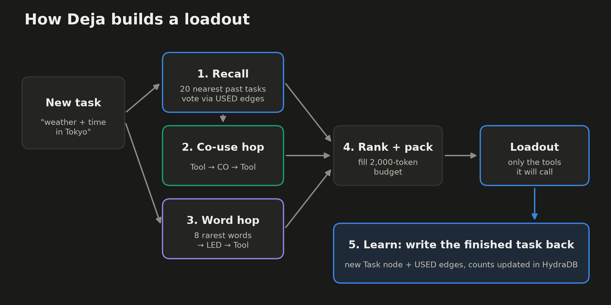

# Deja: learned tool loadouts for agents, on HydraDB

**Live demo: https://deja-hydradb.vercel.app** · [Article on X](https://x.com/AymanKhan90/status/2122198078967226712) · MIT licensed


Agents now sit in front of hundreds or thousands of MCP tools. Preloading them all burns the context window, and plain
tool search over descriptions misses the tools a task *actually* ends up calling, especially the second server a task
needs. **Deja remembers, in a HydraDB graph, what past tasks needed, and gets sharper with every task it serves.**

## Results

**The served model learns only from tool calls that worked** (12–15% of recorded calls errored), abstains when nothing in
the catalog fits, falls back to plain tool search when memory has nothing close, and reads the live tool catalog from the
graph. Each of those is measured below. First, the core comparison, which learns from and scores *every called tool*:

8,612 tasks run against real MCP servers (Toucan-1.5M: questions LLM-generated from each server's tools, tool calls
really executed) · 2,236 tools across 367 servers · 2,000-token budget.
Metric: share of tasks where **every** tool the agent called was already in its **first** loadout.

| Method | All tasks | Called tools on 2+ servers (31%) |
|---|---|---|
| Tool search: vector top-k over tool descriptions | 37.4% | 19.0% |
| Load whole servers, vector-ranked | 43.5% | 12.6% |
| Vector + learned popularity (non-graph learner) | 43.0–43.5% | 22.8–24.6% |
| **Past-task memory, no graph** (20 nearest past tasks vote for their tools) | 64.6–64.9% | 36.7–37.2% |
| Deja v1, first shipped: word + co-use edges, no task memory | 52.4–53.2% | 27.3–28.4% |
| **Deja**: task memory in HydraDB + co-use hop + word hop | 66.7–67.3% | 39.5–40.6% |
| Deja without word edges (ablation) | 65.7–66.3% | 37.2–37.6% |
| Deja without co-use edges (ablation) | 65.8–66.4% | 39.5–40.8% |

**Held out, live from HydraDB:** on 200 tasks the served graph never learned from (all answerable), every tool that worked was in the first loadout for **76.4%** vs tool search 40.2%; loadouts carried a chronically broken tool 21.5% of the time vs 39.0% for tool search. The served policy answered with Deja on 198, fell back to tool search on 0 and abstained on 2. Graph reads per loadout p50 89 ms / p95 178 ms. Every served decision and loadout is identical to the in-memory twin (`matches_oracle: True`).

**Read this table honestly.** Memory of past tasks does most of the work: a plain vector store of past tasks, with no
graph, already gets most of the lift over tool search. The graph adds on top of that: Deja keeps the memory as
`(:Task)-[:USED]->(:Tool)` in HydraDB and adds a word hop and a co-use hop, worth about 2.5 points overall and about 3
on multi-server tasks. Per the ablations, the word hop carries the multi-server gain; the co-use hop adds about 1 point
overall and roughly nothing on multi-server tasks. Our first shipped version (v1) had no task memory and lost to this baseline. A reviewer added the
baseline, we reproduced it, and we rebuilt around it. The v1 row stays in the table.

Evaluation is **prequential**: every task is scored *before* Deja learns from it, so the x-axis is literally "tasks
served". Ranges cover 4 orderings (dataset order and 3 shuffles). One row per Toucan `prompt_id`; only 36 of 8,612
question texts are exact duplicates, and 1.8% of tasks have an earlier task at cosine ≥ 0.95. Weights are not tuned per
ordering: vote weight 1.0 and K=20 come from one check on shuffle 1, and word weight 0.5 and co-use weight 0.2 are
unchanged from v1. The stream numbers use an in-memory twin of exactly the served model; the twin is checked equal to
HydraDB reads on the held-out set and in `python hydra_store.py`, which also checks the per-task learning path: bulk-load
300 tasks, ingest 100 one at a time, and require identical loadouts on the next 100.


**Learning curve** (shuffle 1, log-spaced buckets so the cold start is visible):


| tasks already served | 0–50 | 50–100 | 100–200 | 200–400 | 400–800 | 800–1,600 | 1,600–3,200 | 3,200–6,400 | 6,400–8,612 |
|---|---|---|---|---|---|---|---|---|---|
| Tool search | 34% | 30% | 38% | 38% | 41% | 36% | 37% | 38% | 38% |
| Past-task memory, no graph | 38% | 26% | 45% | 43% | 54% | 55% | 62% | 69% | 71% |
| Deja v1 | 38% | 30% | 45% | 42% | 49% | 50% | 51% | 54% | 55% |
| Deja | 38% | 26% | 40% | 42% | 54% | 58% | 65% | 71% | 74% |

**Other token budgets** (shuffle 1):

| token budget | 1,000 | 2,000 | 4,000 |
|---|---|---|---|
| Tool search | 26.5% | 37.4% | 48.2% |
| Past-task memory, no graph | 50.9% | 64.9% | 74.0% |
| Deja | 52.3% | 67.2% | 76.8% |

### Learning only from calls that worked

`(:Task)-[:USED]->(:Tool)` used to record that a tool was *called*, so a call that errored still earned votes. Toucan
stores each executed call's response; a call counts as failed if its response opens with an error (HTTP 4xx/5xx,
missing API key, crash, "unknown tool"). Hand-check: 40/40 sampled flags were real failures, and 28/30 unflagged
responses were real successes (the two misses' patterns were then added). 21% of tasks contain a call that never
succeeded. The served model writes the outcome as the edge type, `USED` for successes and `FAILED` for failures, and
only successes vote or count. Mean of 3 shuffles; "chronically broken" = fails in ≥ 80% of the ≥ 10 tasks that call it:

| | Every tool that worked loaded | Every called tool loaded | Loadout has a chronically broken tool |
|---|---|---|---|
| Tool search | 40.0% | 37.4% | 35.0% |
| Past-task memory, learning from every call | 67.1% | 64.8% | 43.1% |
| Deja, learning from every call | 69.3% | 67.2% | 43.9% |
| Past-task memory, successes only | 67.7% | 60.3% | 21.4% |
| **Deja, successes only (served)** | 69.9% | 61.9% | 18.8% |
| Deja, successes only + reliability penalty (dropped) | 63.5% | 51.5% | 3.4% |

On the tools that worked it is as good or slightly better, and loadouts carrying a broken tool drop by more than half.
It no longer loads tools whose calls failed, so the every-called-tool number falls; both are reported. The graph keeps
its lead over the memory-only baseline built the same way.

### Knowing when nothing fits

Toucan has no "no suitable tool" tasks, so we built them. Cluster servers by tool embeddings (single-linkage at cosine
0.85), hold out whole clusters plus every server within 0.80 of them (3 seeds, about 37 servers each), and call a task
unanswerable only if all its servers were removed **and** no remaining tool resembles any tool it needed (tool-tool
cosine < 0.80; hand-checked substitutes score 0.83–0.93, non-substitutes 0.52–0.78). Without that substitute check,
about half the "unanswerable" weather tasks still had a working weather server left. Unanswerable tasks per seed:
431, 317, 368.

How well each signal separates answerable from unanswerable tasks (AUROC, 3 seeds, warm memory): closest past task 0.84–0.89, best tool match 0.66–0.78, top vote share 0.70–0.81, neighbour agreement 0.70–0.78, server spread 0.41–0.45, co-use coherence 0.52–0.54.
The abstain rule is a two-feature logistic regression (closest past task, best tool match) fit on seed 1 and tested on
seeds 2 and 3:

| Allowed wrong abstentions (fit on seed 1) | No-fit tasks caught (seed 2 / 3) | Answerable wrongly abstained (seed 2 / 3) | Same, with graph signals added: caught |
|---|---|---|---|
| 2% | 21% / 12% | 2% / 2% | 20% / 11% |
| 5% (served) | 46% / 31% | 5% / 5% | 46% / 29% |
| 10% | 67% / 49% | 11% / 11% | 69% / 50% |
| 20% | 83% / 71% | 22% / 21% | 84% / 69% |

**The graph doesn't help here.** Adding the graph signals (vote share, neighbour agreement, server spread, co-use
coherence) changed the catch rate by −2 to +2 points, so the served rule uses similarity only. Cold-start fallback
(plain tool search when the closest past task is below 0.69): 69.5% → 69.6% (seed 2), 69.8% → 69.9% (seed 3); it helps in the first few hundred tasks and is
neutral after.

### Tools come and go

The catalog is graph state: `(:Catalog)-[:LISTS]->(:Tool)`. When a server drops a tool from `tools/list`, Deja deletes
one edge; every read is filtered to the live catalog, whatever memory says.

**The removal test, on HydraDB:** learn a task that used tool A → remove A from the catalog → repeat the task. Over 40 cases, A was never loaded again (40/40) and the token budget was still packed (40/40).

**Removing 10% of tools mid-stream** (3 seeds, tasks still answerable afterwards): reading the live catalog keeps 74.1% success, against 72.8% when trusting stale memory, which also spends 140 tokens per loadout on tools that no longer exist. Tool search: 40.6%.

## How it works



```
(:Task) -[:USED]-> (:Tool)                                   every past task and the tools that worked for it
(:Task) -[:FAILED]-> (:Tool)                                 calls that errored (recorded, never vote)
(:Catalog) -[:LISTS]-> (:Tool)                               the live tool catalog
(:Term {df}) -[:LED]-> (:Link {n}) -[:TO]-> (:Tool {uses})   a word in past tasks → the tool that solved them
(:Tool) -[:CO]-> (:CoLink {n}) -[:TO]-> (:Tool)              tools used together in one task
```

0. **Abstain or fall back:** a two-feature rule (closest past task, best tool match) decides first. If nothing fits,
   load nothing and say why; if no past task is close, use plain tool search; otherwise continue.
1. **Recall similar tasks:** embed the task (bge-small) and pick the 20 most similar past tasks by cosine (numpy, a plain
   vector index). Read their `USED` edges from HydraDB in one id-anchored batched read; each votes for its tools,
   weighted by similarity. `fused = cosine(task, tool) + 1.0 · votes`.
2. **Co-use hop:** from the top 5 of the fused ranking, walk `CO` → `CoLink` → `Tool` to the tools those are
   usually used with (about +1 point overall).
3. **Word hop:** from the task's 8 rarest words (highest idf), walk `LED` → `Link` → `Tool`, weighted by learned counts.
   Limiting it to 8 words cut the rows read about 4× and slightly *raised* accuracy. This hop carries most of the
   multi-server gain (about +3 points).
4. **Rank and pack:** `fused + 0.5 · words + 0.2 · co-use`, packed greedily into the token budget.
5. **Learn:** after the task, write a `Task` node with `USED` (worked) and `FAILED` (errored) edges, and update the word
   and co-use counts from the calls that worked. All reads are filtered to the tools the `Catalog` node currently lists.

HydraDB specifics that shaped the design:
- Batch writes can set node properties but not edge properties, so counts live on reified `Link` and `CoLink` nodes.
- List parameters are rejected outside `UNWIND`, so multi-key reads use scalar parameters.
- The vote hop uses the id-only batched read shape, which skips per-row property reads.
- The served graph keeps word links seen ≥ 2 times, at most 10 per word.

## Under load

16 concurrent planners computing full loadouts (task-vote, word and co-use reads) from one single-node HydraDB while a learner keeps writing new tasks: **0 errors**, 11.6 loadouts/s, p50 1364 ms, p95 2072 ms, 36 tasks learned meanwhile. A single planner gets 3.0/s at p50 307 ms, so 16 planners give 3.8× the throughput. Correct under contention; throughput is the ceiling of one node on one machine. HydraDB scales reads by adding
query nodes over the same object store, which we haven't done here.

## Limitations

- **Synthetic questions, real execution.** Toucan's questions were generated by an LLM from each server's tool set, so
  similar tasks recur by construction, which favours any past-task memory (ours and the baseline's). Organic agent
  traffic may recur less. The tool calls and their results are real.
- **Cold start.** Deja is level with tool search for roughly the first 400 tasks it sees (38.8% vs 36.8% on shuffle 1).
  The fallback to tool search softens it but doesn't remove it. A hosted version would start warm from memory shared
  across a team's agents.
- **Abstaining is partial.** At 5% wrong abstentions it catches 31–46% of tasks with no fitting tool. The benchmark's
  "no fitting tool" labels come from held-out server clusters and an embedding-based substitute check, not from people.
- **Failure detection is a text heuristic** on the recorded responses, hand-checked on a sample, not ground truth.

## What we measured and threw away

- **Shared entity memory** ("reuse IDs other agents already resolved") was our first headline, with kill criteria set
  before building. It failed them: binding precision was 21%, and even a perfect binder would save only 6.3% of lookups
  beyond a plain `(tool, args)` cache.
- **Graph signals for abstaining** (neighbour agreement, server spread, co-use coherence) added nothing over plain
  similarity; the abstain rule doesn't use them.
- **A reliability penalty** on top of learning from successes cut broken tools to 3% of loadouts but cost about 6 points.
  Too blunt; dropped.
- **Data-flow edges** (a value from one tool's output reappearing verbatim in a later tool's arguments) are real but rare.
  Removing them moves the result by 0.1 points, so they aren't part of the claim.
- **Real tool chains are shallow:** only 2.8% of traces have 3 or more calls linked by data flow. One-hop traversals are
  enough; deep path search isn't needed.
- **Offered vs called:** 43% of tasks *offer* tools from 2 or more servers, but 31% *call* tools on 2 or more servers.
  The tables use "called".
- **HydraDB on the local-filesystem store** can't publish index generations or hand a restarted node its write lease,
  because it lacks conditional PUT. Reads crawled (about 4 s) until we moved it onto S3 (RustFS) with `graph-indexer`
  running. `hydra.sh` runs all three containers.

## Run it

```bash
./hydra.sh                          # RustFS (S3) + HydraDB graph-node + graph-indexer; BUCKET=name picks a graph
uv sync
# data: two Kimi-K2 shards of Toucan-1.5M (about 310 MB)
for i in 00000 00001; do curl -L -o data/raw/kimi_$i.parquet \
  https://huggingface.co/datasets/Agent-Ark/Toucan-1.5M/resolve/main/Kimi-K2/train-$i-of-00040.parquet; done
uv run python retr.py 2000          # prequential eval, 4 orderings -> data/results_v2_2000.json
uv run python hydra_store.py        # HydraDB loadouts == in-memory twin (asserts)
uv run python load.py 16            # 16 concurrent planners + 1 learner writing
uv run python outcome.py            # learning only from calls that worked -> data/outcome.json
uv run python abstain.py            # abstention benchmark + cold-start fallback -> data/abstain.json
uv run python lifecycle.py          # tool removal on HydraDB + mid-stream removal -> data/lifecycle.json
uv run --with matplotlib python charts.py docs/img
uv run python server.py             # bulk-load graph, held-out check, page + /api/loadout on :8090
./deploy.sh ubuntu@<vm>             # Ubuntu VM (x86_64 or arm64), opens port 80
uv run python make_readme.py        # regenerate this README's tables from the results
```

`sim.py` is the killed entity-memory experiment, kept so those numbers reproduce. `spike_paths.py` is the hour-one
HydraDB spike (weighted paths, multi-type `MSpaths`, a concurrent writer).
